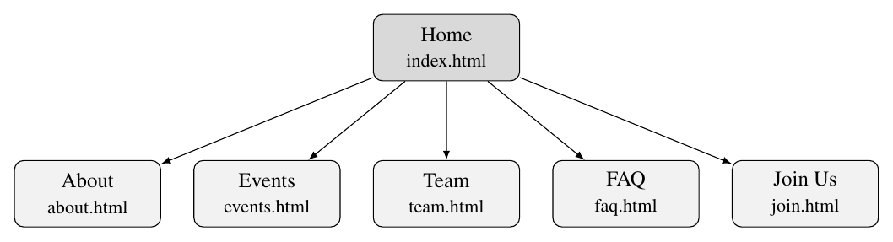
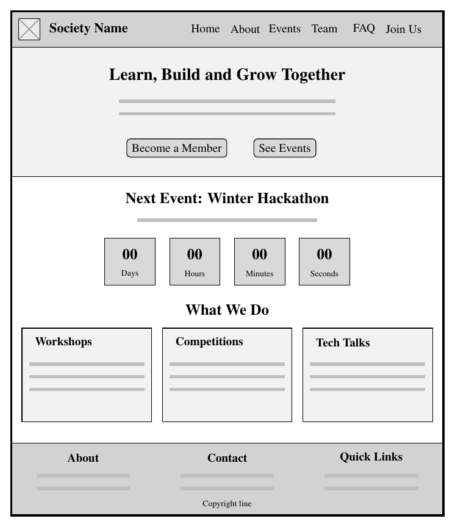
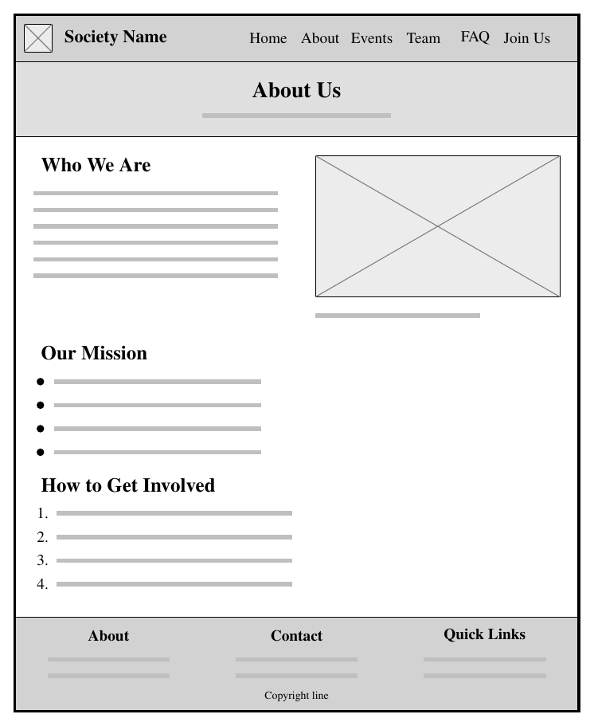
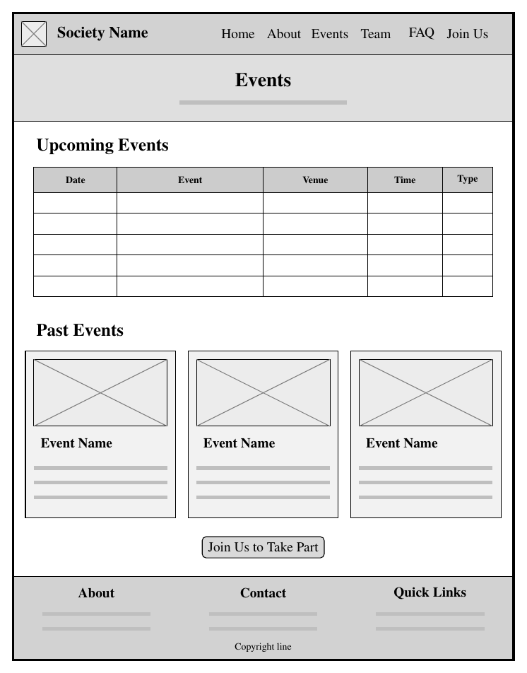
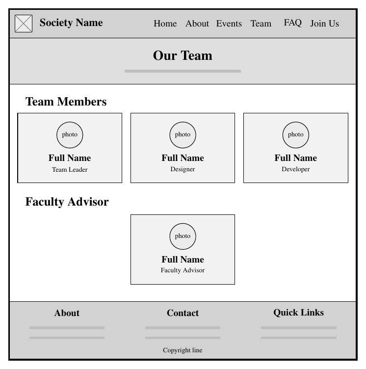
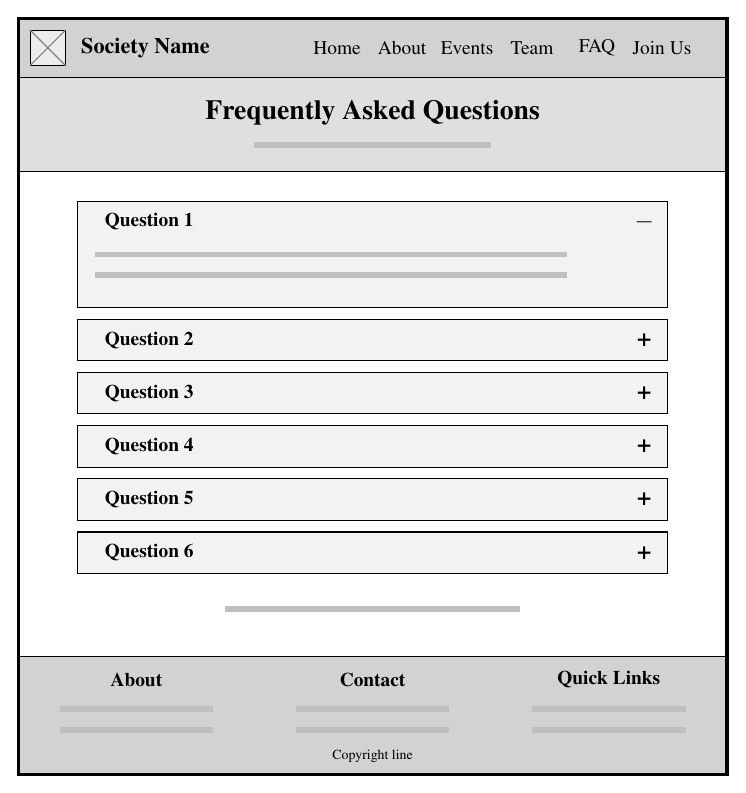
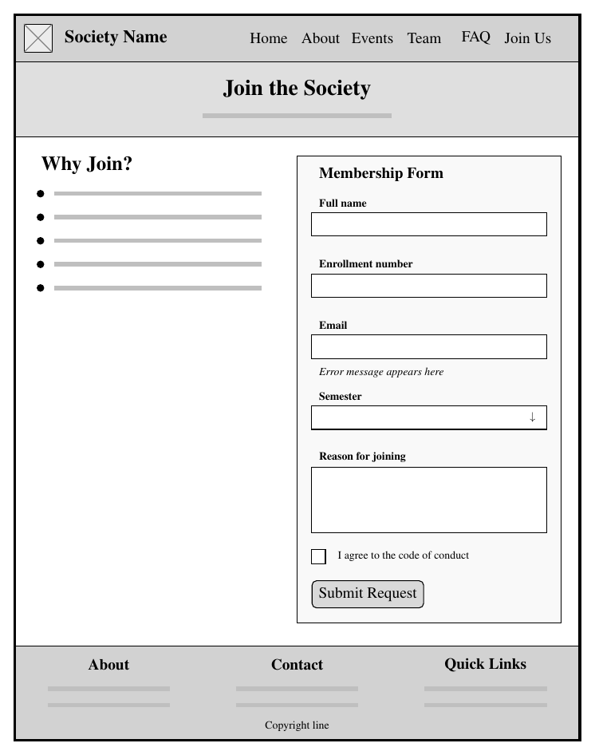

# Bahria Computing Society Website

A website for the Bahria Computing Society, a student society of the Department of Computer Science, Bahria University, Islamabad.

**Course:** CSC-114 Introduction to ICT, Fall 2026
**Instructor:** Ms. Nadia Kalsoom
**Group name:** Bahria Computing Society

## Purpose

The society has no website. Its news is spread over WhatsApp, Instagram and the notice board, so students miss events and joining is slow. This website puts everything in one place: what the society does, upcoming and past events, common questions, and an online membership form.

## Team members

| Member | ID | Main role |
|---|---|---|
| Muhammad Farooq Rehan | 01-134262-058 | LaTeX Report, GitHub repository |
| Tauheed Ahmad Zia | 01-134262-097 | Wireframes, CSS and  HTML pages |
| Muhammad Abdullah | 01-134262-0 | Requirements, JavaScript and testing |

## Pages

| Page | File |
|---|---|
| Home | `index.html` |
| About | `about.html` |
| Events | `events.html` |
| Team | `team.html` |
| FAQ | `faq.html` |
| Join Us | `join.html` |

## Technologies

HTML5, CSS3, JavaScript, Git and GitHub, Overleaf (LaTeX report).

## Site map

Every page has the same menu, so any page is one click from any other page.



## Wireframes

### Home


### About


### Events


### Team


### FAQ


### Join Us


## How to run

1. Download or clone this repository.
2. Open `index.html` in a web browser (Chrome, Firefox or Edge).

No server or installation is needed.

Live site (GitHub Pages): 

## Folder structure

```
society-website/
|-- index.html
|-- about.html
|-- events.html
|-- team.html
|-- faq.html
|-- join.html
|-- README.md
|-- css/style.css
|-- js/main.js
|-- js/form.js
|-- js/events.js
|-- images/
`-- wireframes/
```
